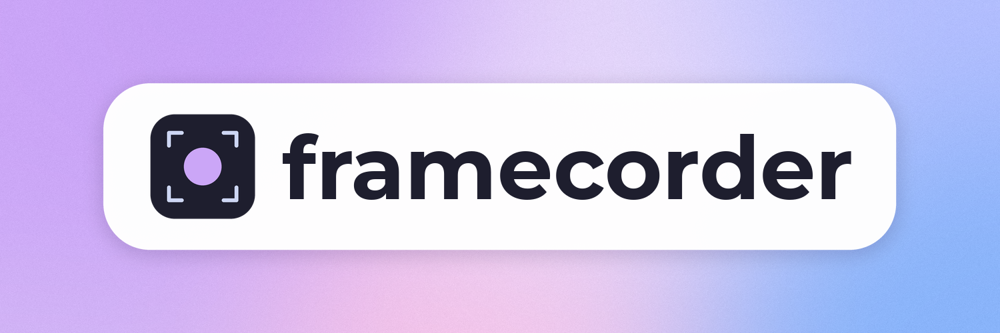

# framecorder

a recorder for the steam frame that grabs what the headset panels ACTUALLY show, without eating the headset's performance. the point is footage that looks like the frame really feels, not the laggy stuff other recorders make.

it runs right on the headset. there's a tab in the steamvr dashboard with a big record button, or you can drive it over ssh.

## what it costs

measured on a steam frame (snapdragon 8 gen 3, adreno 750), 1920x1080 hevc:

- gpu: about 0.6 ms per recorded frame at 500 MHz, a lot less at gameplay clocks. it runs on a high priority queue, so it gets its turn right after each refresh even in a heavy game (a low priority one starves there: missed frames, and torn ones, since the compositor draws the next frame into the same buffer)
- cpu: about 5-7% of ONE core with game audio + mic, out of 8, about 2% more with split tracks
- ram: about 10 MB of its own, the rest is shared libraries
- the dashboard tab: under 1% of a core, sleeps when the menu is closed, only redraws when something changes
- video encoding: the snapdragon's hardware encoder, so no cpu or gpu time there

## how it works

pixels never touch the cpu.

1. wait for the display's vblank, look at which buffer the vr compositor is scanning out to the panels
2. import that buffer into vulkan as-is (zero copy, compressed ubwc tiling and all)
3. one small compute shader crops it, undoes the lens distortion and color fringing (using steamvr's own lens data), scales it and converts it to nv12, writing straight into a buffer the encoder reads
4. the hardware encoder (qcom iris, v4l2) makes hevc or h264
5. a separate thread muxes that with aac audio from pipewire into a hybrid mp4 (or an mkv)

so it's what's on the panels, passthrough, overlays, dashboard and all, NOT steamvr's mirror window.

the long version, lens math and all, is in [docs/how-it-works.md](docs/how-it-works.md).

## views and shapes

- 16:9 (default), 1:1 and 9:16: one eye un-warped from what the panels show, level, centered vertically where the lens shows the most (about 16° above straight ahead, like steamvr's own view) and as wide as it goes without black edges (about 77° square, 64° x 96° tall). read with a sharp catmull-rom filter so it holds up next to steam's recorder. `--fov` overrides the width
- left eye, right eye, or both eyes blended (`--eye left`, `right`, `both`): blended is one flat video looking straight out, a bit wider than one eye: your dominant eye wherever it can see, and the other eye filling in past its inner edge with a short fade, the same way steamvr's own "both eyes" views do it. in the tab it's "Both, left dominant" or "Both, right dominant" under video, next to left and right (`--dominant left` or `right`, right by default), and the apps offer them too. something close to your face can ghost a little in that fade, off to the side, that's the two eyes disagreeing
- promo footage (settings, files, off by default): a switch for when you're capturing footage to cut together. with it on, a recording also saves every other view next to it, each in its own file ending `-left`, `-right`, `-both` or `-lenses`, with the game's sound so they line up in an editor. the eye views keep your shape. each view is one more recorder reading the panels and one more encode, so it costs the game more than a normal recording: turn it off again when you're done. it needs the panels, and it's only in the tab, not the apps
- both panels (`--view raw`): both panels exactly as scanned out, distortion included

`--source headset` records SteamVR's headset view instead, the picture Steam's own recorder saves (16:9 left eye only on the frame). steamvr only renders it while someone's recording it, so it costs the game about 0.45 ms of gpu per frame and a few reprojected frames. the panel source costs the game nothing measurable, so it's the default.

the frame rate defaults to the panel's refresh rate (72 or 90), or half of it at 120/144, so every frame is evenly spaced. `--fps 60` forces 60, tho it'll judder a bit if the panel's at 72.

## audio

game audio is on by default, and the tab records the mic too (toggle it off in the tab, or `--mic` on the command line). the mic gets mixed into the main track so every player plays it, and while you talk the game drops under your voice, so a loud game never drowns you out. with split tracks on (the default, under audio in settings), the game and the mic also get a track each for editing (`--mic-track` on the command line). the frame mutes its own mic whenever the headset's off your head, so tests on the desk come out silent. plug in a usb mic or connect a bluetooth headset and a mic picker shows up under audio, so you can record from it instead of the frame's own (`--mic-source` on the command line). left alone, framecorder records whichever mic steamos uses.

## clips

clips are on by default (the switch is under the record button, the length is in settings, clips: 15 s, 30 s, 1 min, 2 min).

framecorder keeps that much of the last few seconds in temporary segments on disk, with their locations in ram. it falls back to ram if it can't write the segments. then any of these saves it to `clips` in your recordings folder (`~/Videos/framecorder/clips` unless you picked a card or drive):

- hold the left thumbstick down (to rebind it, "change in steamvr" under clips in settings)
- the clip button in the tab

it's always on, no recording needed. a little note floats up in front of you and the controller buzzes when it's saved. the buffer is just the already encoded video, nothing gets re-encoded.

old segments are freed as the buffer moves on, once no clip being saved still needs them. starting a recording turns the buffer off, since the recording has it all anyway, and it comes back on when you stop.

on the command line: `framecorder --replay 30 --control`, then type `clip` (or `record <file>`, `stop-record`, `pause`, `resume`, `quit`).

## sync to your phone or computer

`framecorder-sync` runs on the headset and hands finished clips and recordings to the framecorder app (windows, macos, linux, android) over wi-fi, as soon as they're saved. pair from the tab: settings, sync, "pair a device" shows a qr code and a code to type. it only syncs while the frame is on, on the same wi-fi, with framecorder running. transfers go full speed, sending a file doesn't touch the gpu or the encoder. if you stream pc vr over the same wi-fi and it stutters during a sync, set `game_rate_mb` in `~/.config/framecorder/sync/settings.json` (8 is a good start). the desktop app's in `desktop/`, the android app in `android/`, the service in `sync/`, each with its own readme.

on the old 0.1.x desktop app? it can't update itself, so download the new app once from [the site](https://framecorder.coah80.com/) and open or install it. your pairings and settings carry over, and the new app closes the old one for you.

## watch it live

a paired app can watch what the headset shows while it happens. it's the same video the recorder makes (same shape, eye and quality as your settings, game audio and mic mixed in), sent over wi-fi. while it's already recording or keeping clips, watching costs the headset no extra encoding. nothing runs until someone's watching, and it stops when you stop it or close the app.

on the desktop app, "live" in the sidebar. start it and it plays right there, and shows a local address like `http://127.0.0.1:38620/live.ts` with a copy button. (if that port's busy the app picks another, so copy the one it shows.) to record it with obs:

1. in obs, under sources, hit + and pick media source
2. uncheck "local file"
3. paste that address into input, and ok

obs plays it like any other source, so record, stream or crop it from there. anything else that opens a url works the same (vlc, ffmpeg). on android, "live" in the app plays it on the phone. both apps go fullscreen with it (the button on the picture), with sound, so you can cast or airplay the screen to a tv. from a terminal, `framecorder-app live` prints the address and waits.

a few things to know: the tab says when someone's watching. while the framecorder tab itself is on screen the stream holds its last frame, the same as recordings, so the controls never end up on it. a headset on an older framecorder doesn't have live yet, the app tells you to update it.

## install

on the frame, in desktop mode, open konsole and run:

```sh
curl -fsSL https://framecorder.coah80.com/install | sh
```

(over ssh from a computer works too.) that gets the installer, a little terminal app built on [opentui](https://github.com/anomalyco/opentui) (`installer/`, about 30 MB since bun comes along), and runs it. clicking install asks for your password first (if steamos doesn't have one yet, it has you pick one). it's not optional: reading the panels, which is what framecorder records, takes a permission only steamos can give, so without it nothing gets installed. then it downloads the latest release, puts everything in place, starts it, and unlocks the panels with that password. after that it updates itself: a timer (`framecorder-update.timer`) looks for a new release every 6 hours, swaps the files in, and the tab restarts into the new version once nothing's recording. to turn that off: settings, general, "automatic updates". updates and the installer leave it off, and the update button in the apps still works. run the installer again to update right away (the desktop and android apps offer that too when a new version is out), or to remove framecorder. the script is `site/install`, the site workflow builds the installer with `installer/build.sh`.

if the panels ever end up locked anyway (the panel helper below got deleted, say), the tab doesn't just stop: it records steamvr's headset view (16:9, left eye, about 0.45 ms of the game's gpu a frame) and says so, until the installer's run again.

unlocking puts the panel helper in place: `framecorder-grab`, a tiny program owned by root in `~/.local/lib/framecorder` with `cap_sys_admin` (reading another process's framebuffers needs it). it's the only part of framecorder with a permission, and it does one thing: turn a framebuffer into a dmabuf the recorder can read, passed over a socket (`src/grab.rs`). a permission lives on the file it's given to, and updates replace files, so it's not the recorder that holds it: updates never touch the helper and the panels stay unlocked.

work happens on `dev`. `main` is what's released: the site deploys from it, and everything people download comes from its releases, so pushing to `dev` changes nothing for anyone. when it's time for a release, merge `dev` into `main`, bump the versions (`Cargo.toml`, `sync/Cargo.toml`, `app/Cargo.toml`, `desktop/Cargo.toml`), and make the release.

making a release, on the headset: `packaging/release.sh`, then put both files in `dist/` (the tarball and its `.sha256`) on a github release. the site workflow copies them to the site's `/dl`, where the installer and the updater get them.

or build it yourself. on the headset, with developer mode on and ssh working:

```sh
curl -sSf https://sh.rustup.rs | sh -s -- -y --profile minimal
git clone --branch dev https://github.com/coah80/framecorder framecorder && cd framecorder
./install.sh
```

it builds the headset package and runs the same `framecorder-setup` as a release install, asking for your password once to unlock the panels through the helper. that installs the recorder, tab, sync service and updater.

the tab starts now only if steamvr is already running, otherwise it starts with steamvr next time. when setup finishes, open the steamvr dashboard and look for the framecorder tab.

the tab only ever attaches to a steamvr that's already running. connecting as an overlay app is allowed to launch steamvr's server itself, and a server started from outside steamvr's own launcher leaves the headset stuck on passthrough, so it checks first and waits.

needs gcc, clang, glslc, pipewire and vulkan headers, which the frame's image already has. it builds its own small ffmpeg the first time (a few minutes), so a steamos update can't break the recorder.

## uninstall

run the installer again and pick remove, or over ssh, `framecorder-ui --uninstall`. it stops the services and deletes the programs, settings and pairings. your videos stay in `~/Videos/framecorder`, and on any card or drive you recorded to.

## using it

open the steamvr dashboard, there's a framecorder tab. the first screen is the record button, clips, and a list of what's set up (video, quality, audio, clips) with what's paired under it. tap a row or "settings" to change things, one section at a time. the chip next to the title says whether it's recording the panels or steamvr's view. videos are hevc, or h.264 for players and sites that can't take hevc (settings, video, codec). files are hybrid mp4, like obs's: if the headset dies mid-recording, everything up to the last couple of seconds is still there. mkv is under settings, files, with a switch to remux recordings to mp4 once they stop (clips stay mkv). hit record, then switch to another tab or close the menu and it starts. it pauses by itself whenever the framecorder tab is on screen, so the controls never end up in your video, just come back to it and hit stop. files go to `~/Videos/framecorder`, or to a `framecorder` folder on a microSD card or USB drive (settings, files, folder). if that drive is taken out, recording carries on into `~/Videos/framecorder` until it's back.

(it goes by the tab and not the whole dashboard because on the frame the steam menu counts as open the whole time you're in home)

it starts with steamvr. to stop it, tab, recorder, clips and sync, until steamvr starts again: settings, "close framecorder" at the bottom. to bring it back sooner, pick framecorder from "launch program" on the frame's app bar, or press play on it in the steam library. if you'd rather open it only when you want it, turn off settings, general, "start with steamvr". updates leave that how you set it.

something broke? see [report an issue](#report-an-issue) below.

or from ssh:

```sh
framecorder                          # left eye, 16:9, game audio, until ctrl+c
framecorder --aspect 9:16 --mic      # vertical with the mic mixed in
framecorder --eye both blended.mp4   # flat view blended across the eyes
framecorder --view raw clip.mkv      # both panels, distortion and all
framecorder --duration 30 --qp 20    # 30 seconds at a fixed quality
kill -USR1 <pid> / kill -USR2 <pid>  # pause / resume
```

`framecorder --help` has the rest.

## report an issue

every app has a "report an issue" button on its main screen: the tab's home screen, the desktop app, and the android app. type what went wrong, look over what's going with it, and send. it opens an issue on [github](https://github.com/coah80/framecorder/issues) for you, posted by cobby-bot, and hands you the link.

what goes with it, so nobody has to ask for it afterwards: the framecorder version and whether the panels are unlocked, the steamos and steamvr versions, the headset's model, memory, free disk and battery, the recording settings, which apps are paired, any errors from the last two days, and the recent part of the logs (framecorder's own and steamvr's). the apps add their version, os and their own log. the issue is public, so the app shows you the summary first, and the full json if you want to read it. your home folder and user name, your steam name and login, the names of your devices, every ip address, email addresses, mac addresses, serial numbers, pairing codes and keys are scrubbed out before anything's sent, and your videos are never opened.

over ssh, `framecorder-ui --report "what went wrong"` does the same, and `framecorder-ui --diagnostics` prints exactly what would be sent.

## the discord

there's a discord for questions, ideas and complaints. the desktop and android apps have a "join the discord" button next to "report an issue". it opens [discord.coah80.com](https://discord.coah80.com), which counts the visit (which app it came from and which country, nothing else) and passes you on to the invite.

## anonymous stats

framecorder says one small thing about itself once a day, so we can see how many people use it and which versions are out there:

- the tab on the headset: its version, roughly how long it's been installed (new today, under a week, under a month, under three months, longer), and what was made since the last time: how many recordings and clips, how many minutes of recording, how many times someone watched live or started a recording from an app, and how many bug reports were sent. plus how its settings stand: shape, eye, dominant eye, quality, frame rate, codec, format, clip length, whether clips, the mic, split tracks, the panels, start with steamvr and automatic updates are on, whether it saves to the headset or a card, and how many devices are paired (none, 1, 2, 3 or more)
- the desktop and android apps: which app it is, its version, what it runs on (windows, macos, linux, android), roughly how long it's been installed, how many files it brought over since the last time and their size, how many headsets are paired, and a few of its own switches (background sync, notifications, grid or list and the processor type on desktop, the wallpaper switch and the android version on the phone)

the service also counts which country a message came from and the hour it arrived, from the connection itself, and keeps only those two totals.

that's all of it. there's no id in it, no names, nothing from your videos, and no address is kept: the service adds each message to a total for the day and throws the message away, so it can't tell one install from another. it never runs while you're recording.

to turn it off: settings, general, "anonymous stats" in the tab, and "anonymous stats" in each app's settings. the code that sends it is `src/stats.rs` and `app/src/core/stats.rs`, and the service that counts it is `stats/`.

## notes

- mp4s get finished when the recording stops cleanly, which includes ctrl+c, ssh dropping, and the dashboard tab quitting. if the headset dies mid recording, the `.mp4.part` still plays up to the last couple of seconds, and the tab names it back next time it starts
- raw view costs about 3x the gpu of eye view since it has to read all 37 MB of both panels every frame
- the fonts in the dashboard tab (montserrat, poppins, space grotesk) are under the sil open font license, see `assets/fonts`
